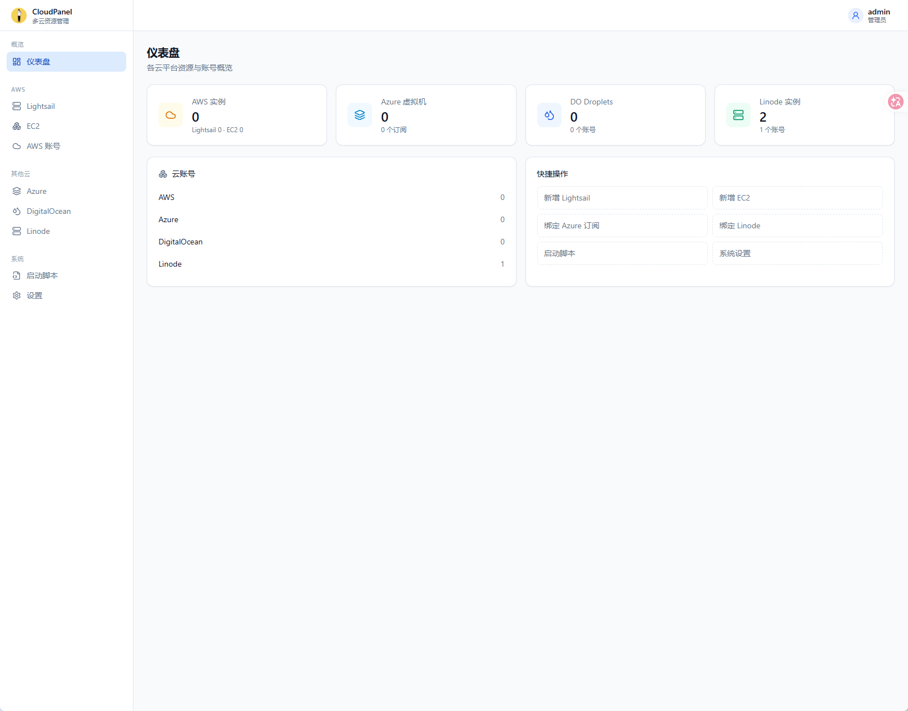

# CloudPanel

[](https://github.com/jianming18/new-cloudpanel/actions/workflows/docker-publish.yml)
[](LICENSE)
[](https://github.com/jianming18/new-cloudpanel/pkgs/container/new-cloudpanel)

CloudPanel 是一个开源的多云服务管理平台，通过统一的界面管理 AWS、Azure、DigitalOcean 和 Linode 等云服务资源，支持实例的创建、开关机、删除、计费概览与登录信息管理。

## 功能特性

### 多云实例管理
- **AWS**：Lightsail 轻量服务器与 EC2 云服务器，支持创建、开关机、重启、更换 IP、全球加速器（AGA）
- **Azure**：虚拟机创建与管理，支持开机/关机/重启/删除、更换公网 IP
- **DigitalOcean**：Droplet 创建（cloud-init 下发 root 密码）与删除
- **Linode**：实例创建与电源管理
- 实例状态自动轮询刷新，过渡态无需手动刷新页面

### 登录信息一键查看
点击实例列表中的任意实例，即可弹出该实例的登录信息：
- 公网 IP / 登录用户 / SSH 端口 / root 密码
- 密码默认打码，支持显隐切换与一键复制
- 附带可直接复制的 `ssh -p 端口 用户@IP` 命令
- 仅通过面板创建的实例会记录密码，导入的实例显示"未记录"

### 账号与安全
- 多云账号统一管理（API Token / AccessKey / 订阅凭证）
- 余额与配额展示（DO 月度账单、Linode 余额与优惠、AWS 配额）
- 面板用户体系与 Django Admin 管理后台

### 工程化
- 前后端分离：Django 4.2 RESTful API + React 18 (TypeScript + Vite + pnpm)
- 容器化部署：Docker Compose 一键拉起（nginx 前端 + Django/Gunicorn 后端 + Redis + Celery）
- CI/CD：推送自动构建多架构镜像并发布到 ghcr.io
- 双平台流水线：GitHub Actions 发布到 GHCR，[CNB 云原生构建](./docs/cnb-build.md) 发布到 CNB Docker 制品库
- 离线依赖构建：后端使用 wheelhouse（预编译 wheel）安装，前端使用 pnpm 全局存储缓存，构建不依赖现场联网解析

## 快速开始

### 一键安装（推荐）

GitHub 源（默认）：

```bash
bash <(curl -L https://raw.githubusercontent.com/jianming18/new-cloudpanel/refs/heads/main/install.sh)
```

CNB 源（国内推荐，脚本、配置文件与镜像均从 `cnb.cool` 拉取）：

```bash
bash <(curl -L https://cnb.cool/mrzhang193/new-cloudpanel/-/git/raw/main/install.sh) --cnb
```

`--cnb` 会把配置文件源切到 CNB 仓库、镜像源切到 CNB Docker 制品库
（`docker.cnb.cool/mrzhang193/new-cloudpanel`）；不加则沿用 GHCR + GitHub。
升级时请沿用同一个源：用 `--cnb` 安装的就用 `--cnb update`。

脚本将自动完成 Docker 安装、环境配置、镜像拉取、服务启动，并初始化默认管理员。

**安装完成后：**

| 项目 | 值 |
|---|---|
| 访问地址 | `http://<服务器IP>:8086` |
| 默认账号 | `admin` |
| 默认密码 | `admin123` |

> 首次登录后请立即在「右上角 → 修改密码」中更改默认密码。

**更多命令：**

```bash
# 一键升级（GitHub 源）
bash <(curl -L https://raw.githubusercontent.com/jianming18/new-cloudpanel/refs/heads/main/install.sh) update

# 一键卸载（GitHub 源）
bash <(curl -L https://raw.githubusercontent.com/jianming18/new-cloudpanel/refs/heads/main/install.sh) uninstall

# 一键升级（CNB 源）
bash <(curl -L https://cnb.cool/mrzhang193/new-cloudpanel/-/git/raw/main/install.sh) --cnb update

# 一键卸载（CNB 源）
bash <(curl -L https://cnb.cool/mrzhang193/new-cloudpanel/-/git/raw/main/install.sh) --cnb uninstall
```

### 手动部署

#### 方式一：使用官方镜像（推荐）

```bash
git clone https://github.com/jianming18/new-cloudpanel.git
cd new-cloudpanel

# 生成环境配置
cp .env.example .env
# 编辑 .env: 填写 DJANGO_SECRET_KEY (必填), 按需调整端口

docker compose up -d
```

#### 方式二：从源码构建（离线依赖，小内存机器友好）

```bash
git clone https://github.com/jianming18/new-cloudpanel.git
cd new-cloudpanel
cp .env.example .env

# 构建后端镜像 (wheelhouse 离线安装, 无需联网解析依赖)
docker build -t cloudpanel-api:local .

# 构建前端镜像 (直接使用仓库内置的 web/ 构建产物)
docker build -f Dockerfile.web -t cloudpanel-web:local .

# 将 docker-compose.yml 中 ghcr.io 镜像名替换为本地镜像后启动
docker compose up -d
```

> 如需从源码重新构建前端，先安装 [pnpm](https://pnpm.io/)：`corepack enable` → `cd frontend && pnpm install && pnpm build`，产物输出到 `web/`。

### 镜像直拉

```bash
# GitHub Container Registry
docker pull ghcr.io/jianming18/new-cloudpanel:latest        # 后端 API
docker pull ghcr.io/jianming18/new-cloudpanel/web:latest    # 前端面板

# CNB Docker 制品库（由 .cnb.yml 流水线发布）
docker pull docker.cnb.cool/mrzhang193/new-cloudpanel:latest        # 后端 API
docker pull docker.cnb.cool/mrzhang193/new-cloudpanel/web:latest    # 前端面板
```

## 系统要求

- Docker 19.03+ 与 Docker Compose（推荐 v2）
- 1 核 1G 以上（低配机器可调低 `GUNICORN_WORKERS`）
- 放行端口：`8086`（面板访问）、`889`（后端 API，可选）

## 服务架构

```
浏览器 ──> :8086 nginx (web 容器, 静态资源 + /api 反向代理)
                │
                ├──> :889 Django API (api 容器: Gunicorn + Celery)
                │         └──> SQLite (data/ 目录持久化)
                └──> Redis (redis 容器: 缓存 + Celery 队列)
```

## 前端页面展示



## 项目结构

```
.
├── apps/               # 业务应用
│   ├── aws/            # AWS (Lightsail / EC2)
│   ├── azure/          # Azure 虚拟机
│   ├── do/             # DigitalOcean Droplets
│   ├── linode/         # Linode 实例
│   └── users/          # 用户与认证
├── frontend/           # 前端源码 (React 18 + TypeScript + Vite + pnpm)
├── web/                # 前端构建产物 (nginx 站点根目录)
├── libs/               # 各云厂商 API 封装
├── config/             # supervisor / nginx 配置
├── wheels/             # 后端预编译依赖 (wheelhouse, 离线安装用)
├── panelProject/       # Django 工程配置
├── docs/               # 说明文档 (含 CNB 构建说明)
├── .cnb.yml            # CNB 云原生构建流水线
├── .github/workflows/  # GitHub Actions 工作流
└── install.sh          # 一键安装脚本
```

## 技术栈

- **后端**：Django 4.2 · Gunicorn · Celery · Redis · SQLite（兼容 MySQL 配置）
- **前端**：React 18 · TypeScript · Vite · Tailwind CSS · Radix UI · wouter · pnpm
- **部署**：Docker · Docker Compose · GitHub Actions / CNB 云原生构建 · GHCR / CNB Docker 制品库

## 开发指南

### 后端

```bash
python -m venv .venv
source .venv/bin/activate      # Windows: .venv\Scripts\activate
pip install -r requirements.txt
python manage.py migrate
python manage.py runserver 889
```

### 前端

```bash
corepack enable                # 启用 pnpm (版本由 package.json 锁定)
cd frontend
pnpm install                   # 安装依赖
pnpm dev                       # 本地开发, /api 自动代理到 127.0.0.1:889
pnpm typecheck                 # 类型检查
pnpm build                     # 构建, 产物输出到 ../web
```

前端约定：

- `src/components/ui/`：基础组件（Button、Dialog、Table 等，shadcn/ui 风格）
- `src/components/`：业务组件（分页、确认弹窗、登录信息弹窗、通用数据表格等）
- `src/pages/`：按云平台拆分的页面，每个云平台分为「账号列表」与「实例管理」两个独立页面
  - `aws/`：账号列表、EC2 实例管理、Lightsail 实例管理
  - `azure/`、`do/`、`linode/`：账号列表、实例管理
- `src/lib/api.ts`：统一请求封装，自动携带 `X-Token` 并处理业务错误码

## CI/CD 与依赖构建优化

推送到 `main` 分支后，GitHub Actions 自动构建并发布镜像到 ghcr.io：

- **build-api**：使用 CI 内 Python 3.11 环境生成离线 wheelhouse（`pip download`），Dockerfile 以 `pip install --no-index --find-links=/wheels` 离线安装——依赖版本全部锁定，构建过程不联网解析，也不会触发原生模块编译
- **build-web**：`pnpm fetch` + `pnpm install --frozen-lockfile --offline`，依赖清单不变时直接命中 Docker 层缓存，秒级完成

> 本地维护依赖后，用 Python 3.11 重新生成 wheelhouse：`pip download -r requirements.txt --only-binary=:all: -d wheels/`
> （GitHub Actions 会在每次构建时用 Python 3.11 重新生成并覆盖，通常无需手动操作）

### CNB 云原生构建

除 GitHub Actions 外，仓库还提供 [`.cnb.yml`](.cnb.yml)，在 CNB 上构建并发布镜像到
**CNB Docker 制品库**（`docker.cnb.cool/...`），与 GHCR 互不干扰：

| 事件 | 行为 |
|---|---|
| `main` 分支 `push` | 构建并推送前后端镜像，Tag 为 `latest` + 短 SHA |
| `main` 分支 `pull_request` | 仅构建校验，不推送制品 |
| 任意 `tag_push` | 构建并推送版本镜像（`v1.2.3` → `1.2.3`）与 `latest` |

流水线通过内置 `CNB_TOKEN` 免密登录制品库，无需配置额外密钥；后端直接使用仓库内提交的
`wheels/` 离线安装依赖。完整配置说明、触发规则、徽章与排障见
[docs/cnb-build.md](./docs/cnb-build.md)。

## 环境变量

完整模板见 [.env.example](.env.example)，常用项：

| 变量 | 说明 | 默认 |
|---|---|---|
| `IMAGE_BASE` | 镜像仓库前缀；切换 CNB 制品库时设为 `docker.cnb.cool/mrzhang193/new-cloudpanel` | `ghcr.io/jianming18/new-cloudpanel` |
| `IMAGE_TAG` | 镜像版本，`latest` 为最新版，可指定版本号 | `latest` |
| `DEBUG` | 调试模式，生产必须为 `0` | `0` |
| `DJANGO_SECRET_KEY` | 安全密钥，**生产必填随机值** | 空 |
| `FRONTENDPORT` | 面板对外端口 | `8086` |
| `BACKENDPORT` | 后端 API 端口 | `889` |
| `SQLITE_PATH` | SQLite 数据库路径（`data/` 卷持久化） | 容器内路径 |
| `GUNICORN_WORKERS` | Worker 数，低配机器建议 1-2 | `2` |
| `ALLOWED_HOSTS` | 允许的域名 | `localhost,127.0.0.1` |
| `CORS_ALLOWED_ORIGINS` | 跨域白名单 | 本机地址 |

## 数据持久化与升级

- 数据库与日志通过 `data/`、`logs/` 目录挂载，升级镜像不丢数据
- 升级后容器启动时自动执行数据库迁移与管理员初始化
- 不同架构（x86_64 / ARM64）镜像仅在发布版本 tag 时构建，Docker 自动匹配架构

## 注意事项

1. **生产环境**请务必：修改默认密码、设置强 `DJANGO_SECRET_KEY`、收紧 `ALLOWED_HOSTS` 与 `CORS_ALLOWED_ORIGINS`、关闭 `DEBUG`
2. 云厂商凭证（API Token / AccessKey）请勿提交到版本控制系统
3. 如遇问题，请提交 [GitHub Issues](https://github.com/jianming18/new-cloudpanel/issues)

## 贡献指南

1. Fork 仓库并创建特性分支 (`git checkout -b feature/AmazingFeature`)
2. 提交更改 (`git commit -m 'Add some AmazingFeature'`)
3. 推送分支并创建 Pull Request

## 许可证

本项目采用 MIT 许可证，详见 [LICENSE](LICENSE)。

## 致谢

本项目基于 [cdntip/cloudpanel](https://github.com/cdntip/cloudpanel) 重构而来。
